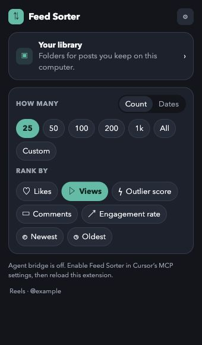

# Instagram Feed Sorter

Sort Instagram Reels and posts by views, likes, comments, engagement, outlier score or date. Save the useful ones, download media, and export your research.

**[Download the latest extension ZIP](https://github.com/princenhammai/instagram-feed-sorter/releases/latest)** · [Installation guide](INSTALL.md) · [Hướng dẫn tiếng Việt](docs/INSTALL.vi.md)

No Node.js, API key, server or developer setup is needed for normal sorting. Each person uses their own signed-in Instagram session.



## Install in a desktop browser

1. Open [Releases](https://github.com/princenhammai/instagram-feed-sorter/releases/latest) and download **`instagram-feed-sorter-v<VERSION>.zip`** under Assets. GitHub's “Source code” archives are for developers and need building.
2. Extract the ZIP into a folder you will keep, such as `instagram-feed-sorter`.
3. Open `chrome://extensions`, enable **Developer mode**, and choose **Load unpacked**.
4. Select the extracted folder containing `manifest.json`.
5. Open Instagram in the same browser, sign in, open a profile's Reels tab, and choose a sort from the extension popup.

This follows Chrome's [official unpacked-extension installation flow](https://developer.chrome.com/docs/extensions/get-started/tutorial/hello-world#load-unpacked). GitHub hosts the download; the extension is not currently listed in the Chrome Web Store.

## Device support

| Browser / device | Status |
| --- | --- |
| Current desktop Chrome on Windows, macOS, Linux or ChromeOS | Primary target; use Chrome 111 or later |
| Desktop Microsoft Edge | Chromium-compatible target; load via `edge://extensions`; not independently browser-tested |
| Other desktop Chromium browsers | May work where the required extension APIs are available; not independently tested |
| Chrome on Android/iPhone/iPad, the Instagram mobile app | Not supported by this package |
| Safari or Firefox | Requires a separate extension port; not supported by this build |

The extension is portable across desktop operating systems. GitHub hosting does not turn a Chrome extension into a phone/tablet app. Google's phone installation flow [adds an extension to your desktop](https://support.google.com/chrome/answer/2664769); it does not run this package on your phone. Microsoft documents [Chrome-to-Edge compatibility](https://learn.microsoft.com/en-us/microsoft-edge/extensions/developer-guide/port-chrome-extension), with API checks and testing required.

## Features

- Sort by views, likes, comments, outlier score, engagement rate, newest or oldest.
- Select 25, 50, 100, 200, 1000, all or a custom number; use date presets or a custom range where supported.
- Filter results and inspect them in the built-in player or on Instagram.
- Export Google Sheets, Excel, CSV, JSON or clipboard data.

## Export the sorted Reels

After you sort a profile, **Export** on the popup or the sorted panel downloads the Reels already captured, in the current sort order. It does not load more posts. Ads and paid partnerships stay out unless **Include ads** is checked. **Copy table** puts the same rows on the clipboard as tab-separated text for Google Sheets.

The file is `<username>-reels-YYYY-MM-DD.csv` in an `Instagram Feed Sorter` folder. It is UTF-8 with a byte order mark so Excel keeps Vietnamese captions. Columns are rank, username, shortcode, url, views, likes, comments, posted date (ISO), caption (first 200 characters), duration seconds, outlier score (views divided by that account's median views), and is_ad. If nothing has been captured yet, the extension shows “Sort the profile first” and does not write a file.
- Download media and keep posts in local folders with the Library.
- Optional video transcription using your own Whisper-compatible provider/key.
- View related accounts suggested by Instagram from the Sorter overlay.

## Data and optional services

Saved posts, media, settings and transcripts stay in this browser. Libraries do not automatically sync between devices. Export/download important saved media before moving or removing an installation.

Sorting uses the Instagram session already in your browser; the extension does not ask for your Instagram password. Google Sheets exports use your own Google session. Transcription sends the selected video/audio to the provider you configure and may incur provider charges. It is optional. See [privacy and permissions](PRIVACY.md).

The extension reads Instagram's web responses. Instagram can change them, hide metrics or limit requests. Start with 25–50 posts. Missing metrics stay unavailable. Browser UI preview and automated tests do not establish full live compatibility on every browser/OS.

## Update an existing installation

Extract a newer release and replace files in the **same folder** you already loaded. Click **Reload** in your browser's Extensions page, then refresh Instagram. Keep the folder path and existing installed extension to preserve its local identity and library.

## Build from source

Use Node.js 22 or newer (CI uses Node 24):

```sh
git clone https://github.com/princenhammai/instagram-feed-sorter.git
cd instagram-feed-sorter
npm ci
npm run typecheck
npm test
npm run test:mcp
npm run package
```

Load `dist/` as an unpacked extension. The ready-to-share ZIP and SHA-256 checksum are written to `artifacts/`. `npm run package:zip` packages an existing production build. The same Node-based packaging script runs on Windows, macOS and Linux.

The advanced local agent bridge is optional; ordinary extension use needs no bridge. See [advanced setup](docs/DEVELOPMENT.md).

## License

[MIT](LICENSE). Bundled dependency notices are included in the release ZIP. This project is independent of Instagram and Meta.
